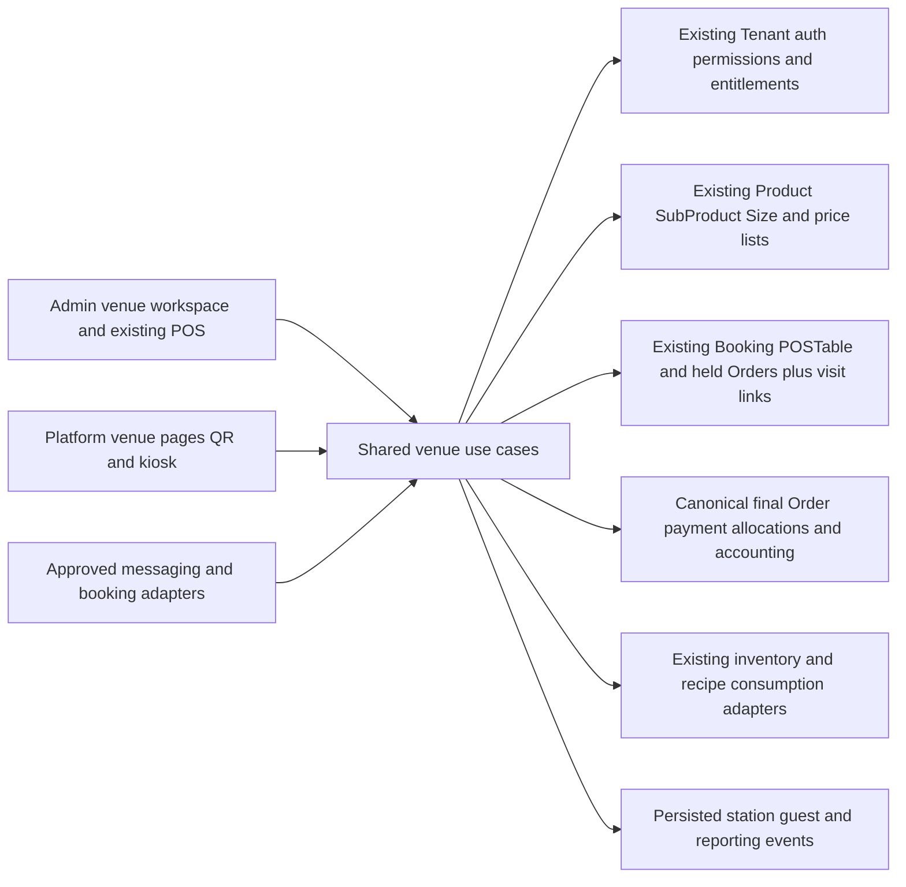

# How all reference features integrate with the current software

[Main design](README.md) · [Evidence](09-reference-evidence.md) · [Restaurant features R01–R18](10-restaurant-integration.md) · [Nightlife features N01–N18](11-nightlife-integration.md)

This chapter is the common integration contract for all 36 mapped feature groups. **[Certain]** existing anchors are source-inspected; **[Likely]** extensions below are design requirements. Feature groups cover the reviewed official pages, not every feature sold by either commercial product.

## 1. One implementation inside DrinksHarbour

The reference products inform behaviour. There is no second Odoo POS, SevenRooms customer database or parallel financial ledger. Keep the currently proposed `VenueServiceSession` as the visit link; names like `ServiceSession` elsewhere are shorthand for the same responsibility.

## 2. Integration ownership and files

Create only the files needed by the phase being implemented. Extract focused use cases from legacy controllers without changing retail contracts unnecessarily.

| Shared boundary | Existing files to adapt | Proposed focused extension | Features |
|---|---|---|---|
| Eligibility/workspace | `Tenant.js`, `posVenue.service.js`, `plan.middleware.js`, existing admin layout/menu | `server/services/venue/eligibility.js`, venue shell and readiness | R01, N01 |
| Floor/capacity | `POSTable.js`, `posTable.controller.js`, `booking.service.js`, table strip/map | `venue/floors.js`, `capacity.js`, `reservations.js` | R02–R04, N02–N04 |
| Tabs/course movement | `pos.controller.js`, held-order API/store and kitchen components | `venue/service-sessions.js`, `line-moves.js`, `courses.js` | R05–R07 |
| Service/stock context | Existing price-list, tax, Size and inventory services | `venue/presets.js`, `menu.js`, recipe/portion adapter | R08; N08–N10 inclusions |
| Preparation/devices | Current fire/bump routes, `pos.realtime.js`, kitchen board/panel | `venue/preparation.js`, `print-jobs.js`, station/device adapter | R09, R10, R17 |
| Financial authority | `tableCheckout.service.js`, POS order settlement, receipt/invoice/payment services | `venue/billing.js`, `payment-allocations.js`, document adapter | R11–R13, N10 |
| Public ordering | Platform `VenuesDirectory.tsx`, venue routes, existing customer auth | Venue menu/reservation/self-order/kiosk components | R14–R16, R18, N14 |
| Guest identity/insights | `POSCustomer.js`, tenant customer/loyalty services, canonical Order | `venue/guest-profiles.js`, `guest-insights.js` | N05–N07, N17 |
| Events/door | Existing Booking plus event/admission proposals | `venue/events.js`, `admissions.js`, `packages.js` | N03, N08, N09 |
| Communication/growth | Existing notification/email services and jobs | `venue/communications.js`, `conversations.js`, `segments.js` | N06, N11–N13 |
| Channels/import/readiness | Existing public routes, staff permissions and jobs | `venue/channel-adapters.js`, `imports.js`, readiness/training UI | N15, N16, N18 |

Service filenames in the proposed-extension column are relative to `server/services/` unless a frontend surface is named. Frontend components stay in the venue folders mapped in chapter 8; integrations do not require another Next.js application.

## 3. Logical data additions

| Responsibility | Minimum contract | Do not duplicate |
|---|---|---|
| Floor/layout | Tenant/location, version, geometry, image, physical table refs | POSTable identity, stock locations or active visit |
| Service preset | Mode, hours, required fields, price/tax refs, station/slot policy | Price calculation or tax registration rules |
| Station/device/print job | Tenant/location, category routes, device identity, line revision, delivery state | Order quantity or consumption ledger |
| Guest extension/consent | POSCustomer ref, scoped tags/preferences, consent provenance and restrictions | Global User identity or wallet/points balances |
| Conversation/messages | Tenant/provider channel, participant verification, delivery IDs and booking refs | Booking confirmation, provider payment authority |
| Import batch | Source, field mapping, external IDs, validation/apply/reconciliation records | Unverified historical money as new receipts |
| Readiness/practice | Configuration/scenario version, staff role, completion evidence | Subscription entitlement or compliance approval |

Some responsibilities can be embedded or reuse suitable existing models. An executable phase plan must fix storage and indexes after auditing callers; this table is not an instruction to create a collection for every row.

## 4. Command and event contract

All authoritative commands carry server-derived `tenantId`, validated `locationId`, authenticated actor, target resource, expected version, idempotency key and correlation ID. Customer/widget/channel input selects an allowed public destination; it cannot create staff authority or submit its own payable totals.

Persist business events after the source transaction commits. Event records carry event ID/type, Tenant/location, source ID/version, UTC time, business date and a minimal safe payload. Consumers deduplicate by event ID plus effect type. Public displays and marketing never consume unredacted guest/payment payloads.

| Event | Required consumer behaviour |
|---|---|
| `venue.booking.confirmed` | Update arrivals; enqueue exactly one versioned customer confirmation |
| `venue.visit.seated` | Refresh floor/host view; notify assigned staff of permitted service flags |
| `venue.lines.fired` | Route frozen line revisions to stations/print jobs; apply recipe effect once |
| `venue.preparation.changed` | Refresh waiter display and anonymised pickup state; no new stock consumption |
| `venue.bill.settled` | Update visit/guest reports and approved loyalty rules; never create another sale |
| `venue.payment.verified` | Allocate stored receipt once to the correct obligation; confirmation still checks capacity |
| `venue.guest.consent_changed` | Update suppression immediately for future marketing attempts |
| `venue.import.applied` | Refresh projections and reconciliation queue; no automatic historical broadcasts |

Notifications are retried delivery effects. They are not the source of truth for booking status. Reports must tolerate delayed projections and disclose freshness; billing/capacity checks read authoritative records.

## 5. Additional API commands

Extend the chapter 6 namespace; keep legacy endpoints as adapters for compatible callers.

| Proposed route | Purpose / important guard |
|---|---|
| `GET/PUT /api/venue-ops/locations/:id/floor-layout` | Versioned configuration; no occupancy writes through layout JSON |
| `POST .../floor-layout/clone` | New resource IDs and safe configuration only |
| `GET/POST /api/venue-ops/service-presets` | Reuse price/tax references and allowed services |
| `POST .../service-sessions/:id/join` | Operational party grouping; preserve settled bills/deposits |
| `POST .../service-sessions/:id/move-lines` | Validated unfired/unpaid quantities, both visit versions and ownership |
| `POST .../service-sessions/:id/courses/:courseId/fire` | Deduplicated release, frozen item/station identity |
| `GET/POST /api/venue-ops/stations` | Configured categories/devices and scoped staff |
| `POST .../preparation/:id/correct` | Permission, reason and linked correction; no automatic stock reversal |
| `POST .../print-jobs/:id/reprint` | Marked duplicate; no second line/fire event |
| `POST /api/venue-ops/waitlist/:id/offer` | Atomic hold and expiry; not a confirmed booking |
| `GET/PATCH /api/venue-ops/guests/:id/profile` | Tenant/role-scoped companion data and safe tag namespace |
| `POST .../conversations/:id/booking-drafts` | Staff-reviewed draft through normal capacity/quote flow |
| `POST /api/venue-ops/imports/preview` | Validate and stage without changing live bookings or money |
| `POST .../imports/:id/apply` | Reviewed batch/version and deterministic external IDs |
| `GET /api/venue-ops/readiness` | Evidence-based configuration and practice status |
| `POST /api/venue-public/visits/:token/lines` | Restricted guest-session ordering, not a staff JWT substitute |
| `GET /api/venue-public/pickup/:displayToken` | Anonymous aliases only; expiring location-bound access |

Provider messaging/device callbacks have their own verified ingress. Do not put credentials into widgets or invent Odoo/SevenRooms API endpoints. Stage API access by capability, ownership and service readiness; a UI preference does not authorise a command.

## 6. Deliberate adaptations

- Preserve central Product/SubProduct ownership rather than importing a separate product-master design.
- Retain Paystack/NGN and the current revenue agreements. Source references to other terminals, US post-payment tips or foreign partners do not change provider capability.
- Use one canonical venue bill with payer allocations; reference-style sub-order views cannot post duplicate revenue.
- Use explicit seating actions, archival of used tables and safe correction events to preserve live obligations/history.
- Separate operational party joins from financial consolidation. After collections start, preserve independent bills or perform audited financial amendments; never silently merge settled transactions.
- Retain recipe consumption when correcting KDS presentation; re-preparation requires another explicit action.
- Support direct/social hosted booking links now in the design; native partner distribution, dedicated phone numbers and hardware require verified adapters before activation.
- Treat loyalty and messaging as existing systems to extend, with consent and financial deduplication; not a new audience database or points wallet.

## 7. Integrated acceptance journeys

1. **Restaurant shift:** R01–R13 configure a location, seat a booking/walk-in, send drinks and courses to separate stations, correct a display mistake, split/settle once, print a receipt and reconcile stock/tips. Moving the table cannot re-fire already-sent lines.
2. **Self-order:** R14–R18 a guest browses a public QR, joins a valid visit, selects modifiers and pays/defers according to policy. A kiosk reset protects the next guest; the pickup board reveals only an alias. Duplicate requests do not duplicate preparation or money.
3. **VIP night:** N01–N12 a request becomes a held/paid reservation, guests arrive in partial groups, host receives a scoped VIP alert, package components are redeemed once and the deposit offsets the same bill. Table guests count against the event cap.
4. **Cross-channel capacity:** N02/N14/N15 host, website, widget and approved adapter compete for one table; one valid claim wins. Private staff allocations and public availability reconcile; attribution never changes ownership or commission without policy.
5. **Guest data:** N05–N07/N13/N17 recognised guests see permitted loyalty/service benefits; an unrelated Tenant sees none of their private history. Refund/replay cannot inflate visits/spend/points; marketing respects the latest suppression state.
6. **Import:** N16 imports guests and future bookings with a duplicate batch retry and ambiguous matches. Apply is idempotent, capacity conflicts enter review and historical paid flags create no real receipts or notifications.
7. **Readiness/recovery:** N18 staff complete role scenarios in isolation; failed printer delivery, unknown payment, stale floor and declined waitlist offer all have a visible recovery path without deleting financial/service history.

Test every R/N row's acceptance as well as these cross-boundary journeys. Use real concurrent MongoDB integration tests for capacity and financial allocation, HTTP tests for permission/tenancy, deterministic tests for amounts and units, and browser/device tests for UI/hardware promises.

## 8. Delivery placement

Use the phases in chapter 8 with these additions: phase 0 fixes eligibility/bill identity; phase 1 adds floor layout, profile/request onboarding and staff practice; phase 2 adds shared capacity and money; phase 3 adds presets/courses/station devices and recipe-aware service; phase 4 adds event/door/VIP workflows; phase 5 adds advanced self-order/kiosk, campaigns, private-line providers, imports and partner adapters as independently tested slices. Move safe migration tooling earlier if pilot data requires it.

All 36 groups belong to the target design. Conditional adapters remain tracked requirements with explicit activation gates; their public source mentions are not treated as delivered integrations. Each coding phase needs its own exact file/schema/test plan and cold-reader handoff.
