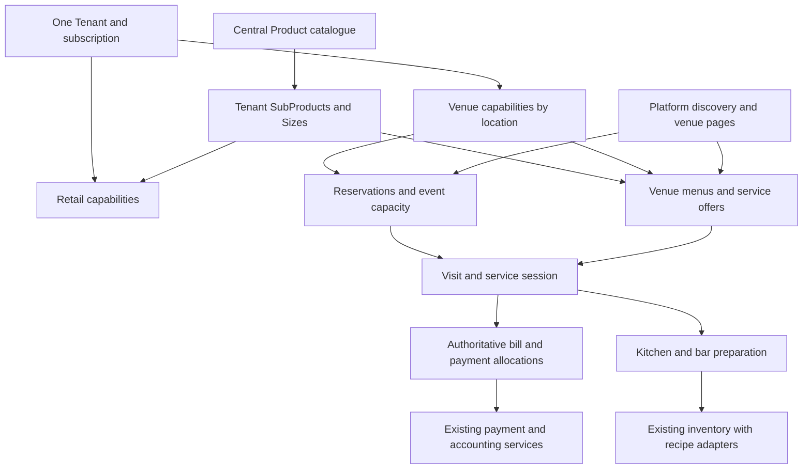

# Venue software and marketplace design

Venues need a hospitality operating system, not a shop dashboard with a different label. Keep the shared Tenant, Product, SubProduct, inventory, payment and accounting foundations; give restaurants, bars, lounges and clubs their own operating tools and customer journeys.

This is the main Markdown handoff. Read the linked chapters for detailed requirements. It is a proposed design, not a claim that the features have been built or approved.

## 1. Confidence and evidence

- **[Certain]** means inspected repository behaviour or a directly supported external fact, as of 17 October 2026. Code inspection does not establish production deployment or end-to-end reliability.
- **[Likely]** means a recommended design inferred from the architecture and hospitality workflows. All requirements outside the current-state chapter are in this category unless marked otherwise.
- **[Guessing]** means an illustrative assumption requiring operator or commercial validation. Examples of menus, deposits, timings and packages are not customer commitments.

The research supports the operational categories, not the exact configuration of an Abuja business. Pilot observation must determine actual service timings, menus, station layouts and commercial terms.

## 2. Documents and reading order

| Chapter | What it decides |
|---|---|
| [Current software and gaps](01-current-state.md) | What exists, what to reuse, conflicts and missing foundations |
| [Venue operations](02-operations.md) | Restaurant, lounge, bar and nightclub workflows; reservations, door and service |
| [Products, menus and inventory](03-products-inventory.md) | Product types, cocktails, food, modifiers, recipes, stock and packages |
| [Venue dashboard](04-dashboard.md) | Navigation, roles, screen layouts, permissions and operational reporting |
| [Customer platform](05-platform-website.md) | Discovery, venue pages, reservations, menus, events and commerce |
| [Architecture and API contracts](06-architecture.md) | Tenant boundaries, entities, APIs, concurrency and integrations |
| [Payments and revenue](07-payments-revenue.md) | Deposits, minimum spend, bills, commission, refunds and reconciliation |
| [Delivery and acceptance](08-delivery.md) | Phases, proposed file map, migration, tests and decisions before launch |
| [Reverse-engineering evidence](09-reference-evidence.md) | Official source ledger, inspected code, confidence and coverage limits |
| [Odoo-informed restaurant integration](10-restaurant-integration.md) | R01–R18: floor plans, courses, transfers, preparation, bills, QR and kiosk features |
| [SevenRooms-informed nightlife integration](11-nightlife-integration.md) | N01–N18: onboarding, guest lists, VIP, messaging, events, imports and training |
| [Shared-system integration contracts](12-integration-contracts.md) | Existing-service mapping, commands/events, adaptations and integrated acceptance journeys |

## 3. Vocabulary and ownership

**Venue = a Tenant operating hospitality services.** “Vendor” in this request means that paying business. In code, `Vendor` continues to mean an external supplier from whom a Tenant buys stock. Do not create a second Vendor account system for venues.

**Business type describes the operation. Subscription describes paid access.** A restaurant does not stop being a restaurant when its subscription expires. A liquor store does not become a nightclub by buying the Venue tier.

**An organisation can do both retail and hospitality.** One Tenant may operate a bottle shop, restaurant and lounge across locations. Each location has explicit capabilities; its tables, service sessions and stock stay scoped to that Tenant and location.

**Packaged beverages retain the central catalogue.** Different retail and venue prices are selling contexts for the same canonical beverage. Do not create a new central whisky Product because one venue serves it by the shot.

**Food and prepared drinks require an explicit catalogue extension.** This design recommends extending Product kinds and tenant-owned service metadata while keeping every sellable menu item linked to a SubProduct. See chapter 3; this extension must precede selling food.

## 4. What changes for each business

| Business | Main work surface | Distinctive needs | Customer entry |
|---|---|---|---|
| Shop | Catalogue, inventory, orders, POS | Sealed items, delivery/pickup, quick payment | Shop products |
| Restaurant | Floor, reservations, service, kitchen | Covers, courses, modifiers, food recipes, allergy handoff | Find a restaurant, menu, book a table |
| Bar | Open tabs, bar queue, stock | Rounds, measured pours, happy hours, cash control | Find a bar, drinks menu |
| Lounge | Reservations, tables, bottle service | Seating zones, group packages, deposits, minimum spend | Reserve a table or package |
| Nightclub | Tonight, door, guest list, VIP tables | Event capacity, admission, promoters, bottle service | Choose a night, join list, reserve VIP |
| Hybrid business | Location-aware combination | Shared procurement; explicit separation of channels and stock | Shop or visit, clearly separated |

These are onboarding presets, not rigid permanent account classes. Enable only the workflows the business actually uses.

## 5. Recommended architecture

This diagram expresses the target responsibility split. `ServiceSession` is proposed; existing held Orders remain the tab storage during initial migration. A new session must reference that tab rather than create another money record.

## 6. Essential product rules

1. Keep staff dashboards private and customer discovery public; reuse the existing apps initially.
2. Distinguish a booking request, a capacity hold, a confirmed booking, a checked-in visit and a paid bill.
3. Give each visit one settlement authority across booking, pre-order and POS entry points.
4. Keep food/beverage stock, table-time capacity and event admissions as separate kinds of availability.
5. Keep retail delivery, venue attendance and scheduled food orders in explicit checkout contexts.
6. Put ordinary sellable-item prices on SubProduct/Size. Menu layout does not become a competing price store.
7. Reserve or consume each stock component once. Preparation waste remains real even after a financial refund.
8. Treat deposits as advance payments allocated to a later bill, never a second sale.
9. Freeze commercial rules at the relevant transaction. Changing tomorrow's menu or commission cannot rewrite yesterday's bill.
10. Check permissions and paid capabilities on the server; hiding a navigation item is insufficient.

## 7. What to build first

The first release should make a real restaurant or lounge reliable for an entire shift: configure a location, publish a beverage menu, request/confirm a table, check in, serve rounds, settle once, reconcile stock and close the shift.

Existing table and kitchen tools reduce that work. Deposit collection follows the shared bill/allocation foundation. Recipe-backed cocktails and food follow stock-consumption support. Event ticketing follows capacity and refund support. Do not advertise these advanced modes before their dependencies work.

The existing Venue price is **₦150,000/month**, configured in `server/config/erm-plans.js`. Keep it as the commercial starting point. This design does not introduce a cheaper venue tier, mandatory new add-on or charge on every offline restaurant sale. Channel-specific commission still needs explicit policy; chapter 7 records the recommendation and unresolved decisions.

## 8. Research references

Checked 17 October 2026. The chapters specify our proposed behaviour; these sources establish reference workflows or payment-provider requirements.

| Source | Supported observation | Design implication |
|---|---|---|
| [Odoo 19 restaurant features](https://www.odoo.com/documentation/19.0/applications/sales/point_of_sale/restaurant.html) and [official documentation source](https://raw.githubusercontent.com/odoo/documentation/19.0/content/applications/sales/point_of_sale/restaurant.rst) | Restaurant floor, service and billing capabilities | HTML fetch timed out, but full official documentation source was read in the expansion; see evidence O1–O4 |
| [SevenRooms nightlife onboarding](https://sevenrooms.com/newcustomer/nightlife/) | Nightlife setup separates availability, guest lists, requests and events; operators use floor plans and guest information | Club operations need a door and event workflow in addition to table sales |
| [Paystack payment verification](https://paystack.com/docs/payments/verify-payments/) | Server verification exposes transaction status; API-call success alone is insufficient | Match successful payment, reference, amount and currency before allocating funds |
| [Paystack webhooks](https://paystack.com/docs/payments/webhooks/) | Events carry a signature; delivery can retry | Authenticate events and process each financial effect once |
| [Paystack refunds](https://paystack.com/docs/payments/refunds/) | Full and partial refunds use an asynchronous provider process | Track refund progress rather than marking money returned when requested |
| [Paystack transaction splits](https://support.paystack.com/en/articles/2132802) | Subaccounts and split groups distribute received payments | Provider splitting and internal revenue accounting are distinct concerns |

No local tax rate, alcohol licence rule, enforceable cancellation fee, payment escrow facility or automatic no-show debit is established by this document. Resolve those specific launch obligations before enabling the corresponding feature.

## 9. Reference-functionality expansion

The user requested the Odoo restaurant and SevenRooms nightlife functionality be added and integrated with the current system. Chapters 9–12 add a documentation-based reconstruction with **18 restaurant and 18 nightlife feature groups**, each mapped to inspected DrinksHarbour foundations, required extensions and acceptance conditions.

This is one integrated DrinksHarbour implementation: existing Tenant and Product/SubProduct ownership, POS, Booking, tables, inventory, customers, payments and accounting remain authoritative. The reference products supply functional requirements; they are not mandatory replacement platforms. Actual connectors to their accounts or to regional partner services require separately verified adapters.

The expansion makes floor editing, service presets, controlled transfers/joins, courses, printer jobs, station corrections, customer status displays, QR/mobile/kiosk modes, venue onboarding, scoped guest insights, communication/marketing, branded widgets, import tooling and staff UAT explicit. Food/recipe support remains the original DrinksHarbour extension, not a feature attributed to the reviewed pages without evidence.

Read chapter 12 for cross-feature contracts and chapters 10/11 for detailed requirements. These supplements extend chapters 2–8; the core isolation, bill, stock, payment and catalogue invariants continue to apply. The target scope is broader, but software implementation has not been performed by writing these documents.
